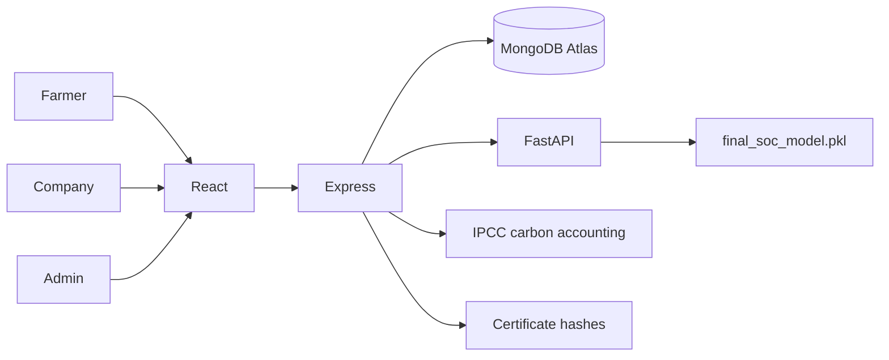
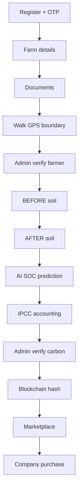
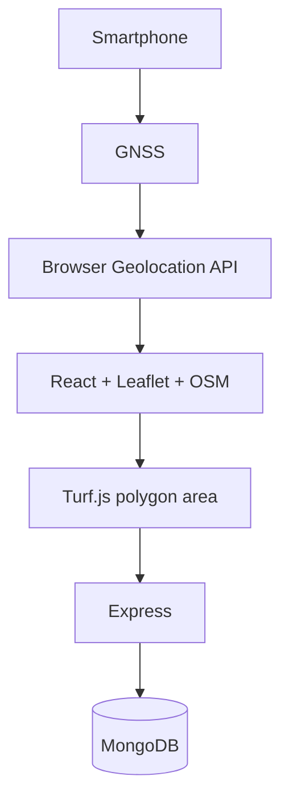
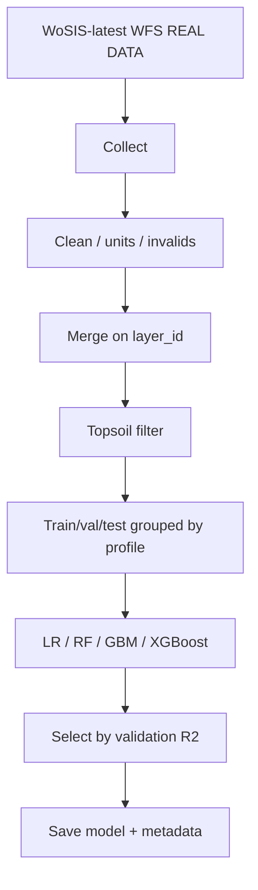

# System architecture and diagrams

## Context



## Farmer to credit



## GPS (small land)



## AI dataset pipeline



## IoT (future, same schema)

```
7-in-1 sensor → RS485/Modbus → ESP32 → Wi-Fi → POST /api/iot/readings
→ SoilReading { stage, inputMethod: IOT }
```

## ER (logical)

User (role) 1—N Farm 1—1 FarmBoundary  
Farm 1—N Document, SoilReading, AIResult, CarbonAssessment  
CarbonAssessment 1—1 CarbonCredit 1—N BlockchainTransaction  
CarbonCredit 1—1 MarketplaceListing 1—N Purchase

## DFD level 0

External: Farmer, Admin, Company, WoSIS (training time only).  
Process: CarbonCreditFarm system.  
Stores: MongoDB, model files, academic ledger.

## State: verification

NOT_SUBMITTED → PENDING → APPROVED | REJECTED | CORRECTION_REQUIRED
